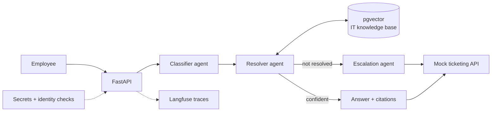

# it-helpdesk-agent

A multi-agent assistant that takes employee IT incidents, finds the fix, resolves what it can and escalates the rest.

> 🚧 Starting point — not built yet

## Problem
Internal IT desks get many repeated incidents: password resets, VPN issues, access requests.
Agents search guides by hand and answer the same questions. Hard cases wait in the same queue as easy ones.
Quality of the automated answers is rarely measured.

## Users & scenario
- **User:** an employee of a fictional software company, and the IT support team behind them.
- **Scenario:** an employee reports "I cannot connect to the VPN". The agent classifies the incident, searches the knowledge base, gives the fix or escalates with a summary to a human.
- **Data:** synthetic IT knowledge base (guides, known solutions) and synthetic incidents. A mock ticketing system. No real company data.

## Architecture

## Tech stack
| Block | Technology |
|---|---|
| **Production baseline** | FastAPI + Pydantic |
| | Evaluation: golden set + LLM-as-judge |
| | Guardrails (prompt injection, sensitive data) |
| | Langfuse (observability) |
| | pytest |
| | Docker |
| | GitHub Actions CI with quality gate |
| | Cloud deploy: TBD (AWS Bedrock or Azure OpenAI) |
| **Deep dive** | Evaluation: golden set, LLM-as-judge, quality gate in CI |
| **Project-specific** | LangGraph multi-agent: classify → resolve → escalate |
| | RAG over the IT knowledge base |
| | Ticketing integration (mock API) |
| | Secrets and identity management |

## Reuses
- The ingestion engine from the finance docs RAG project: read docs → chunk → embeddings → pgvector.
- Only the engine. Not its data.
- Here it loads the IT knowledge base (guides, known solutions).

## Definition of done
- [ ] Each incident is classified, then resolved or escalated; the path is visible in the trace.
- [ ] Answers cite the knowledge base article they come from.
- [ ] Escalations create a mock ticket with a summary and the steps already tried.
- [ ] Golden set of ≥ 40 incidents (classification, resolution, escalation) runs in CI.
- [ ] CI blocks merge when any metric falls below its threshold.
- [ ] No secret in the repo; credentials come from a secret store; the agent acts only with the requester's identity.
- [ ] Guardrail tests cover prompt injection and requests to bypass access rules.

## 5-day build plan
- **Day 1:** synthetic knowledge base and incidents, mock ticketing API, FastAPI skeleton.
- **Day 2:** load the knowledge base with the ingestion engine; retrieval.
- **Day 3:** LangGraph agents: classifier, resolver, escalation.
- **Day 4:** golden set, LLM-as-judge, CI quality gate, guardrails, secrets and identity checks.
- **Day 5:** Langfuse, Docker, cloud deploy, README with real metrics.

## Metrics to report
- Classification accuracy.
- Resolution correctness (LLM-as-judge, calibrated on a human-labelled sample).
- Escalation precision and recall (what should have escalated, and did).
- Citation correctness.
- Share of incidents resolved without a human.
- Latency and cost per incident.

## Run locally
_To be completed when built._
